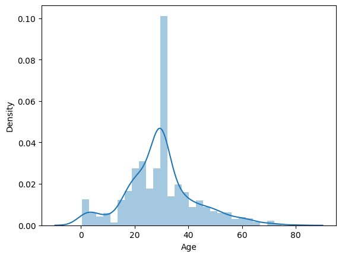

# Titanic Survival Prediction with Logistic Regression

I used logistic regression to predict survival for 891 passengers. It reached 78.8% accuracy on test data, against about 62% from always guessing "did not survive". Training accuracy was 81.3%, so overfitting looks small. I dropped Cabin because 687 values were missing and filled Age with the mean, which is simple and could hide differences between groups. I'd compare other models next.

The spike around age 30 below comes from filling missing ages with the mean.

